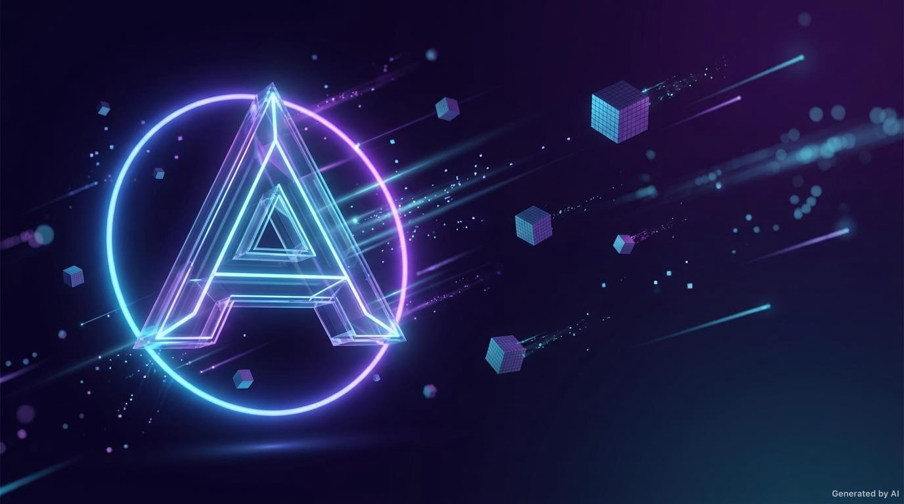

<div align="center">



# Alpinoxi Client

**Şık, hızlı ve her şeyi içeren Minecraft başlatıcısı.**

Electron + React + TypeScript ile yazılmış; HUD, kozmetikler, arkadaşlık/parti sistemi,
Modrinth entegrasyonu, Microsoft / ely.by / offline giriş ve YouTube kanal yönetimi içerir.


</div>

---

## Özellikler

- **Özel açılış animasyonu** — markalı splash ekranı, sonra yumuşak geçiş.
- **Şık, frameless arayüz** — kendi pencere kontrolleri, glassmorphism, canlı gradyanlar.
- **Giriş yöntemleri**
  - **Offline** — Java uyumlu UUID üretimi, yeel skin desteği.
  - **Microsoft** — cihaz kodu (device code) OAuth akışı (XBL → XSTS → Minecraft).
  - **ely.by** — gerçek tarayıcı penceresi (iframe **yok**), oturum çerezleri yakalanır.
- **Kozmetikler**
  - Cape, kanat, şapka, bandana, bot, sırt aksesuarı ve emote kataloğu.
  - **Animated** destekli (dikey sprite sheet işleme).
  - **PNG** olarak cape ve skin yükleme.
  - Microsoft modunda tüm kozmetikler **bedava** + skin changer.
  - ely.by modunda kozmetikler **ely.by penceresinden** yönetilir.
- **Modrinth** — mod / shader / resource pack / datapack arama, sürüm seçimi, bağımlılık çözümleme ile kurulum.
- **Mod paketleri** — `.mrpack` oluştur / dışa aktar / içe aktar; **bağımsız mod paketi** üretimi.
- **Alpinoxi Client modu** — Sodium, Lithium, Iris, FerriteCore, Krypton ve daha fazlasıyla hazır performans paketi.
- **Modsuz (clean) mod** — tamamen temiz vanilla kurulum.
- **Her sürüm, her loader** — Vanilla, Fabric, Quilt, Forge, NeoForge, OptiFine ve Alpinoxi.
- **HUD** — FPS, koordinat, biyom, ping, bellek, tuş vuruşları, CPS, zırh, iksir ve oturum süresi; canlı önizleme.
- **Arkadaşlık + parti** — WebSocket tabanlı sosyal sunucu (`server/index.js`).
- **YouTube** — loopback OAuth ile kanal bağlama ve resumable video yükleme.
- **Performans** — G1GC tabanlı JVM bayrakları, sha1 doğrulamalı paralel indirme.

## Ekran Görüntüleri

> Uygulamayı `npm run dev` ile açıp kendi ekran görüntülerinizi ekleyebilirsiniz.
> Ana Sayfa · Kurulumlar · Modrinth · Kozmetikler · Arkadaşlar · HUD · YouTube · Ayarlar

## Kurulum

```bash
npm install
npm run dev        # geliştirme
npm run typecheck  # tip kontrolü
npm run build      # üretim derlemesi
npm run dist       # Windows kurulum dosyası (release/)
```

### Sosyal sunucu

```bash
npm run social     # ws://localhost:8787
```

Sunucu adresini **Ayarlar > Sosyal sunucu** alanından değiştirebilirsiniz.

## Giriş Ayarları

| Servis | Nereden alınır | Nereye girilir |
| --- | --- | --- |
| Microsoft | [Azure Portal](https://portal.azure.com) → Uygulama kaydı → istemci kimliği | Ayarlar > Microsoft istemci kimliği |
| YouTube | [Google Cloud Console](https://console.cloud.google.com) → OAuth istemcisi (loopback) | Ayarlar > YouTube istemci kimliği / gizli anahtarı |

> Uygulama hiçbir zaman kullanıcı şifresini istemez veya saklamaz. Tüm girişler resmî OAuth /
> tarayıcı oturumu akışlarıyla yapılır.

## Mimari

```
src/
  main/       Electron ana süreç (Minecraft motoru, indirme, giriş, IPC)
    core/     version, loaders, java, http, auth, modrinth, modpack, cosmetics, hud, social, youtube
    ipc/      tek noktadan kayıtlı IPC handler'ları
  preload/    contextBridge köprüsü (window.alpinoxi)
  shared/     IPC sözleşmesi ve tipler (tek doğruluk kaynağı)
  renderer/   React arayüzü (sayfalar, bileşenler, tasarım sistemi)
server/       arkadaşlık + parti için WebSocket sunucusu
```

Veri klasörü: `%APPDATA%\AlpinoxiClient` (Ayarlar'dan değiştirilebilir).

## Lisans

MIT © alpstudios346
